# Tokio 2027 – Design-Leitfaden

Stand: 13.10.2026 (Farben, Tippflächen, Schrift und Zustände am selben Tag in die App übernommen) · Gilt für die App unter https://trax777-cyber.github.io/tokio-2027/

**Wozu dieses Dokument?** Es beschreibt, wie die App vor der Übernahme aussah (**Ist**), und zeigt das Ziel-Design (**Soll**). Übernommen sind inzwischen Farben, Tippflächen, Schrift und Zustände (siehe „Stand der Umsetzung“). Der Rest des Soll steht als Stylesheet in [`soll.css`](soll.css), lebende Beispiele in [`design-beispiele.html`](design-beispiele.html). Die Beispielseite ist unter https://trax777-cyber.github.io/tokio-2027/docs/design-beispiele.html im Browser zu öffnen (Hell/Dunkel umschaltbar).

**Wie ist es entstanden?** Die Tabellen und Bilder mit „Ist“ zeigen den Zustand **vor** der Übernahme. Der Ist-Zustand stammt aus dem Quellcode (`quelle/app.src.html`), die Maße aus dem Browser (Handy-Breite 390 px, Chromium), die Kontraste aus den Farbwerten berechnet (`tools/kontrast.py`). Nicht getestet sind echte iPhones, Android-Geräte, Bildschirmleser und die Karte (die Karten-Bibliothek war in der Prüfumgebung nicht erreichbar).

**Nutzer:** Mathias und Familie. Alter und Sehvermögen der Mitreisenden sind nicht bekannt. Der Leitfaden geht deshalb vom ungünstigen Fall aus: grelle Sonne, eine Hand, Handy in Bewegung.

---

## Stand der Umsetzung (13.10.2026)

| Teil | Status |
|---|---|
| Farben: `--vermillion`, `--gold`, `--focus`, neues `--line-strong` (hell und dunkel) | **in der App** |
| Ränder aller Bedienelemente auf `--line-strong`, Merken-Stern dauerhaft sichtbar | **in der App** |
| Tippflächen: Chip 40, Tab 56, Schließen 44, Pille 44, Knöpfe 44/40, Zoom 44, Suche leeren 44 px | **in der App** (am Handy-Layout gemessen, siehe Abschnitt 8) |
| Schrift: 16 px Basis, Zweittext 14 px, nichts unter 12 px, Ersatzschriften für Japanisch | **in der App** (kleinste Schrift in allen vier Ansichten gemessen: 12 px) |
| Zustände: Hover (nur Maus, aktive Elemente behalten ihre Farbe), Gedrückt, Gesperrt, „Bewegung reduzieren“ | **in der App** |
| Laptop-Layout mit zwei Spalten | offen, `soll.css` enthält nur die breitere Kopfzeile, der Rest braucht Code |
| Karten-Punkte größer, Zurück-Taste, Offline, eigene Schriften, Bildschirmleser-Texte, Merkliste teilen | offen, Code-Änderungen |

Die Bilder „Soll“ in diesem Dokument zeigen den Stand, der jetzt in der App ist.

---

## Kurzfassung

Die App hat bereits ein stimmiges Design (Papier, Tinte, Zinnoberrot, Kanji-Stempel). Das Soll behält es und behebt fünf Dinge:

| # | Was | Ist | Soll |
|---|---|---|---|
| 1 | Kontrast | 5 Farbpaare unter dem Ziel (siehe Abschnitt 3) | alle Paare erfüllen WCAG AA |
| 2 | Ränder von Eingabefeldern, Chips und Merken-Stern | 1,3 bis 1,5 : 1, kaum sichtbar | mindestens 3 : 1 |
| 3 | Schriftgröße | Fließtext 15 px, Kleinstes 10 bis 11,5 px | Fließtext 16 px, nichts unter 12 px |
| 4 | Tippflächen | Chips 34 px, Schließen-Knopf 36 px, „Kopieren“ 30 px | mindestens 40 px, wichtige Knöpfe 44 px |
| 5 | Laptop | eine schmale Spalte (max. 820 px) | ab 1024 px Liste links, Karte rechts, Detail als Seitenleiste |

Dazu kommen Empfehlungen, die Code betreffen (Zurück-Taste, Offline-Betrieb, eigene Schriften, Merkliste teilen). Sie stehen in den Abschnitten 7, 11 und 12.

<table>
<tr><th>Ist, hell</th><th>Soll, hell</th><th>Ist, dunkel</th><th>Soll, dunkel</th></tr>
<tr>
<td>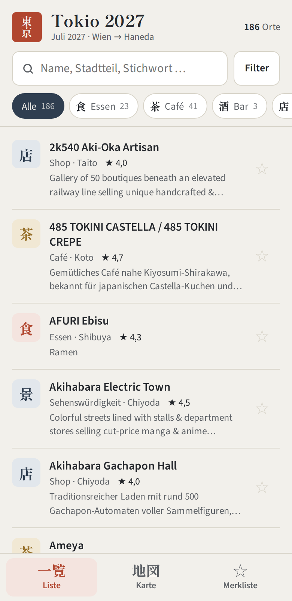</td>
<td>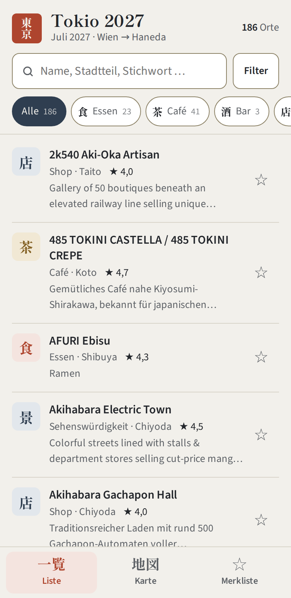</td>
<td>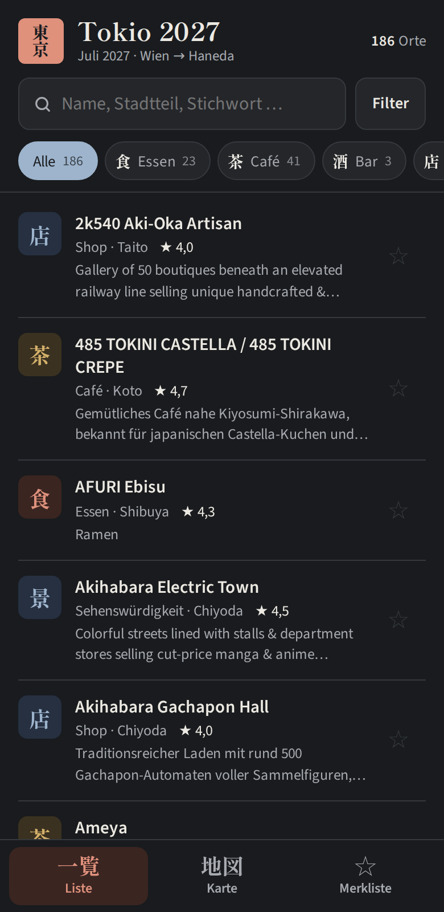</td>
<td>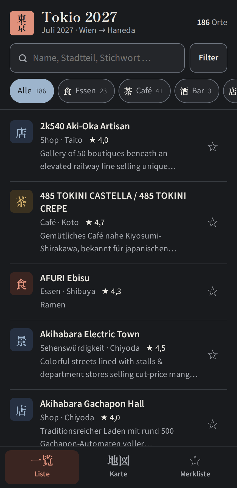</td>
</tr>
<tr>
<td>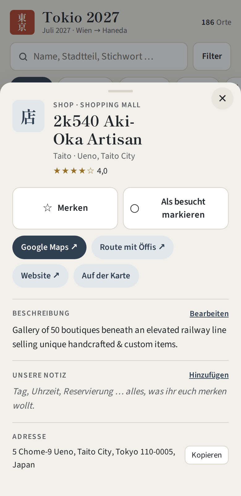</td>
<td>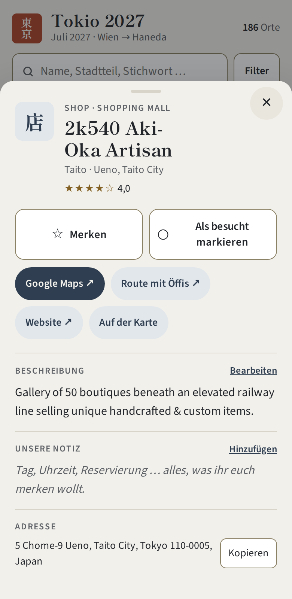</td>
<td>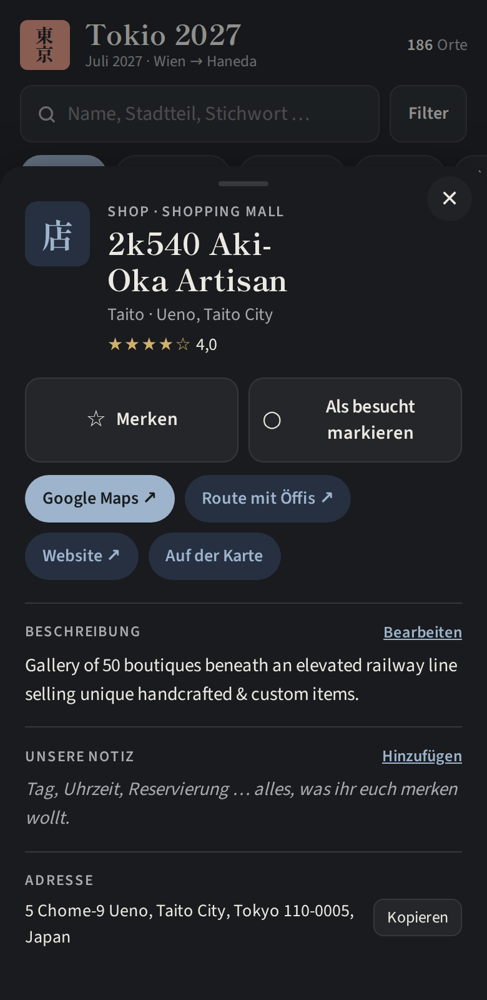</td>
<td>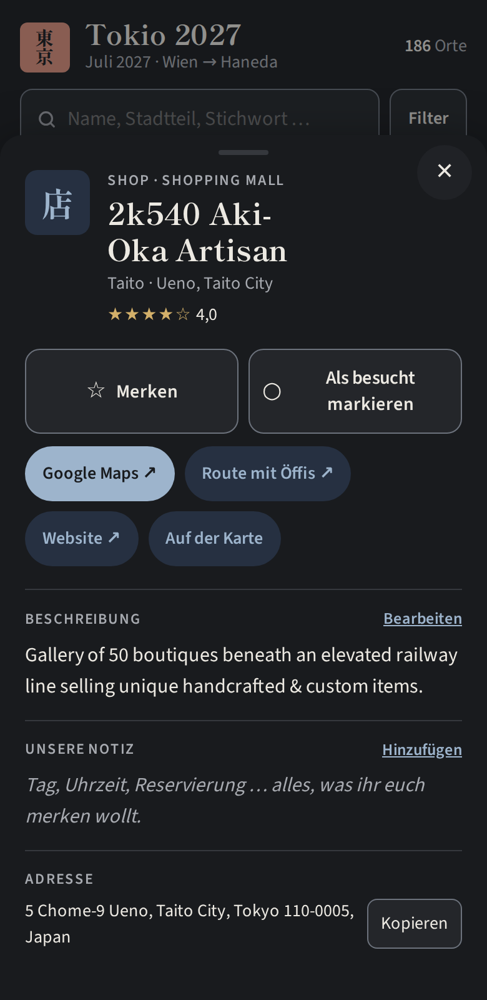</td>
</tr>
</table>

*Die echte App (Handy-Breite 390 px), links Ist, rechts Soll: größere Schrift, kräftigere Ränder, gut erkennbarer Merken-Stern, höhere Tippflächen. Das Soll entsteht ausschließlich aus `soll.css` über dem unveränderten Code.*

---

## 1. Grundsätze

Vier klassische Regeln, auf diese App übertragen:

| Grundsatz | Bedeutung hier | Beispiel |
|---|---|---|
| **Klarheit** | Eine Zeile sagt auf einen Blick: Was ist es, wo ist es, wie gut ist es? | Stempel + Name + „Café · Shibuya · ★ 4,3“ |
| **Konsistenz** | Gleiche Dinge sehen gleich aus und verhalten sich gleich. | Alle Schalter nutzen `aria-pressed` und dieselbe Gedrückt-Optik |
| **Einfachheit** | Drei Tabs, ein Filterblatt, ein Detailblatt. Nichts Weiteres. | Neue Funktionen müssen in diese Struktur passen |
| **Rückmeldung** | Jede Aktion zeigt sofort ein Ergebnis, auch ein Fehler. | Merken färbt den Stern, Speicherfehler erscheinen als Hinweis |

Zwei Grundsätze kommen für diese App dazu:

- **Unterwegs zuerst.** Gestaltet wird für das Handy in der Hand, bei Sonne, mit einem Daumen, oft mit schlechter Verbindung. Der Laptop ist die Planungssituation zu Hause.
- **Japanisch bleibt sichtbar.** Namen, Adressen und Stempel erscheinen in Originalschrift, weil man sie vor Ort zeigen, vergleichen und suchen muss.

## 2. Zielgruppe

Es gibt keine erfundenen Personas. Es gibt zwei Situationen, die sich aus dem Gebrauch ergeben:

| | **Planen** | **Unterwegs** |
|---|---|---|
| Wo | zu Hause, Laptop oder Handy | in Tokio, Handy |
| Hände, Licht | zwei Hände, Innenraum | eine Hand, Sonne oder Nacht |
| Verbindung | gut | mal gut, mal keine (Roaming, U-Bahn) |
| Typische Aufgabe | Orte vergleichen, filtern, Notizen schreiben, Merkliste füllen | Merkliste öffnen, Adresse kopieren, Route starten |
| Wichtig | Überblick, Karte groß | Lesbarkeit, große Tippflächen, schneller Start |

**Familie.** Alle bekommen dieselbe App, aber jede Person hat ihre **eigene** Merkliste, weil sie auf dem Gerät gespeichert wird. Das ist technisch gewollt, im Alltag aber verwirrend, wenn man gemeinsam plant. Empfehlung für das Soll: ein Knopf „Merkliste teilen“ in der Merkliste, der eine Textliste mit Namen und Maps-Links an Nachrichten-Apps übergibt (`navigator.share`, ohne Server). Das ist ein Entwurf und nicht gebaut.

**Wie man die Zielgruppe prüft:** nicht mit Umfragen, sondern mit dem Fünf-Aufgaben-Test aus Abschnitt 11, einmal mit jeder Person, die die App nutzt.

## 3. Farbe

**Haltung.** Papier, Tinte und rotes Siegel erinnern an japanisches Schreibgerät. Das ist eine Gestaltungsidee, keine Forschung. Zur Wirkung von Farben: Sie ist kulturabhängig und weniger gut belegt, als oft behauptet wird. Entscheidend ist hier die **Lesbarkeit**, nicht die Symbolik.

### Palette (Tokens, Soll-Werte)

| Token | Hell | Dunkel | Verwendung |
|---|---|---|---|
| `--paper` | #f2f0eb | #191b1e | Hintergrund |
| `--card` | #ffffff | #24262a | Felder, Chips, Karten |
| `--ink` | #23262b | #ece9e2 | Text |
| `--ink-soft` | #5d6166 | #a7aab0 | Zweittext |
| `--line` | #d8d4c9 | #35383d | Trennlinien (nur dekorativ) |
| `--line-strong` *(neu)* | #8b8165 | #6c727c | Ränder von Bedienelementen |
| `--indigo` | #2f3e50 | #9db4cc | Aktiv, Links, Hauptknopf |
| `--vermillion` | #ae452e *(Ist #b1462f)* | #df917c | Marke, aktiver Tab, Essen |
| `--gold` | #836124 *(Ist #97702a)* | #d3b06a | Merken, Café-Gruppe |
| `--sage` | #4d6a52 | #9bc0a1 | Besucht, Ruhe-Gruppe |
| `--focus` | #145ce9 *(Ist #2f6fed)* | #568af0 | Fokusring |

Zu jeder Farbe gibt es eine helle Fläche (`-soft`) für Stempel und aktive Knöpfe.

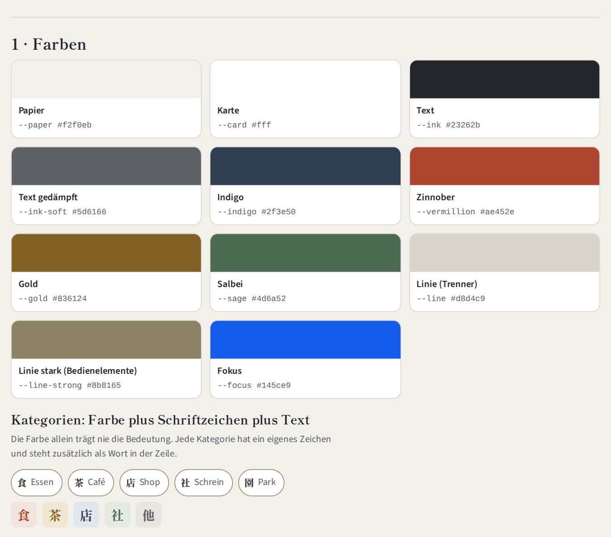
*Soll-Palette hell. Die dunkle Variante: [img/beispiel-farben-dunkel.png](img/beispiel-farben-dunkel.png).*

### Kategorien

Zwölf Kategorien teilen sich fünf Farbgruppen. **Die Farbe allein bedeutet nie etwas:** Jede Kategorie hat ein eigenes Zeichen und steht in jeder Zeile als Wort.

| Gruppe | Farbe | Kategorien (Zeichen) |
|---|---|---|
| Essen & Trinken | Zinnober | Essen 食 · Bar 酒 · Markt 市 |
| Café, Museum, Hotel | Gold | Café 茶 · Museum 館 · Hotel 宿 |
| Shops & Sehenswertes | Indigo | Shop 店 · Sehenswürdigkeit 景 |
| Schreine, Tempel, Parks | Salbei | Schrein 社 · Tempel 寺 · Park 園 |
| Sonstiges | Grau | Sonstiges 他 |

### Kontrast (WCAG 2.2)

Ziele: Text 4,5 : 1, große Schrift und Bedienelemente 3 : 1 (WCAG 1.4.3 und 1.4.11). Berechnet mit `python3 tools/kontrast.py`.

| Paar | Ziel | Ist hell | Soll hell | Ist dunkel | Soll dunkel |
|---|---:|---:|---:|---:|---:|
| Fließtext | 4,5:1 | 13,33 ✓ | 13,33 ✓ | 14,23 ✓ | 14,23 ✓ |
| Gedämpfter Text (Beschreibung, Untertitel) | 4,5:1 | 5,48 ✓ | 5,48 ✓ | 7,41 ✓ | 7,41 ✓ |
| Gedämpfter Text auf Karte | 4,5:1 | 6,24 ✓ | 6,24 ✓ | 6,51 ✓ | 6,51 ✓ |
| Notizzeile (Zinnober auf Papier) | 4,5:1 | 4,87 ✓ | 5,00 ✓ | 6,97 ✓ | 6,97 ✓ |
| Aktiver Tab: Zinnober auf Zinnober hell | 4,5:1 | 4,49 ✗ | 4,61 ✓ | 5,78 ✓ | 5,78 ✓ |
| Stempel Essen & Trinken | 3,0:1 | 4,49 ✓ | 4,61 ✓ | 5,78 ✓ | 5,78 ✓ |
| Stempel Café, Museum, Hotel | 3,0:1 | 3,69 ✓ | 4,66 ✓ | 6,21 ✓ | 6,21 ✓ |
| Stempel Shops & Sehenswertes | 3,0:1 | 8,76 ✓ | 8,76 ✓ | 6,22 ✓ | 6,22 ✓ |
| Stempel Schreine, Tempel, Parks | 3,0:1 | 4,93 ✓ | 4,93 ✓ | 6,92 ✓ | 6,92 ✓ |
| Knopf „Gemerkt“: Gold auf Gold hell | 4,5:1 | 3,69 ✗ | 4,66 ✓ | 6,21 ✓ | 6,21 ✓ |
| Knopf „Besucht“: Salbei auf Salbei hell | 4,5:1 | 4,93 ✓ | 4,93 ✓ | 6,92 ✓ | 6,92 ✓ |
| Aktiver Chip: Papier auf Indigo | 4,5:1 | 9,58 ✓ | 9,58 ✓ | 8,08 ✓ | 8,08 ✓ |
| Zähler an Merkliste: Papier auf Gold | 4,5:1 | 3,95 ✗ | 4,98 ✓ | 8,37 ✓ | 8,37 ✓ |
| Zähler am Filter: Papier auf Zinnober | 4,5:1 | 4,87 ✓ | 5,00 ✓ | 6,97 ✓ | 6,97 ✓ |
| Stern gemerkt (Gold auf Papier) | 3,0:1 | 3,95 ✓ | 4,98 ✓ | 8,37 ✓ | 8,37 ✓ |
| Stern ungemerkt: Linie → gedämpfter Text auf Papier | 3,0:1 | 1,30 ✗ | 5,48 ✓ | 1,47 ✗ | 7,41 ✓ |
| Rand von Eingabefeld/Chip auf Karte | 3,0:1 | 1,48 ✗ | 3,87 ✓ | 1,29 ✗ | 3,13 ✓ |
| Fokusring auf Papier | 3,0:1 | 3,99 ✓ | 4,93 ✓ | 3,79 ✓ | 5,17 ✓ |

**Im Ist verfehlt:** aktiver Tab hell (4,49), Knopf „Gemerkt“ hell (3,69), Zähler an der Merkliste hell (3,95), Stern ungemerkt (1,30 hell, 1,47 dunkel) und die Ränder der Eingabefelder (1,48 hell, 1,29 dunkel). Das Soll behebt alle mit drei kleinen Farbänderungen und einem neuen Token (`--line-strong`).

**Regeln**

1. Text immer aus Token-Paaren der Tabelle. Neue Paare erst nach Kontrastprüfung.
2. Trennlinien dürfen blass sein (`--line`), alles, was man bedient, braucht `--line-strong`.
3. Hell und Dunkel folgen dem Gerät (`prefers-color-scheme`). Beide gelten als gleichwertig und werden geprüft.

## 4. Typografie

**Schriften (Ist, beibehalten):** *Shippori Mincho* (Serifen, Titel, Stempel, Tab-Zeichen) und *Source Sans 3* (Text). Mincho trägt den japanischen Charakter, Source Sans bleibt auch bei kleiner Größe gut lesbar.

**Lücke:** Source Sans hat keine japanischen Zeichen. In „RUMBLE CRUMBLE 渋谷本店“ springt der Browser für 渋谷本店 auf eine beliebige Systemschrift. Soll: feste Ersatzliste (`Hiragino Sans`, `Yu Gothic`, `Noto Sans JP`), steht in `soll.css`.

### Größen (Soll)

| Stufe | Größe / Zeilenhöhe | Gewicht | Verwendung | Ist |
|---|---|---|---|---|
| Titel | 22 px (ab 720 px: 26) / 1,2 | Mincho 700 | App-Titel | 22 / 26 |
| Überschrift | 24 / 1,2 | Mincho 700 | Ortsname im Detail | 24 |
| Unterüberschrift | 18 bis 20 / 1,3 | Mincho 700 | Filter-Titel, leerer Zustand | 18 bis 20 |
| **Text** | **16 / 1,5** | Sans 400 bis 600 | Name, Beschreibung im Detail, Eingaben | 15,5 / 15 |
| **Zweittext** | **14 / 1,5** | Sans 400 | Untertitel, Beschreibung in der Liste, Adresse | 13 |
| Etikett | 12 / 1,4, Großbuchstaben, Abstand 0,08 em | Sans 600 | Abschnittsnamen, Zähler, Hinweise | 10,5 bis 12 |

**Regeln**

- **Nichts unter 12 px.** Im Ist liegen Zähler bei 10,5 und 11 px, das Haken-Etikett bei 11,5 px. Einzige Ausnahme: der Pflichthinweis der Karte (Quellenangabe von Leaflet und Esri) mit 11 px.
- Eingabefelder bleiben bei 16 px, sonst zoomt iOS beim Antippen hinein (im Ist bereits so).
- Zeilenhöhe 1,5 im Fließtext, weil Latein und Kanji gemischt vorkommen.
- Ziffern in Zählern und Bewertungen tabellarisch (`font-variant-numeric: tabular-nums`, im Ist vorhanden).
- Der Seitenzoom darf nie gesperrt werden. Der Viewport im Ist ist korrekt (`width=device-width, initial-scale=1`, ohne `user-scalable`).

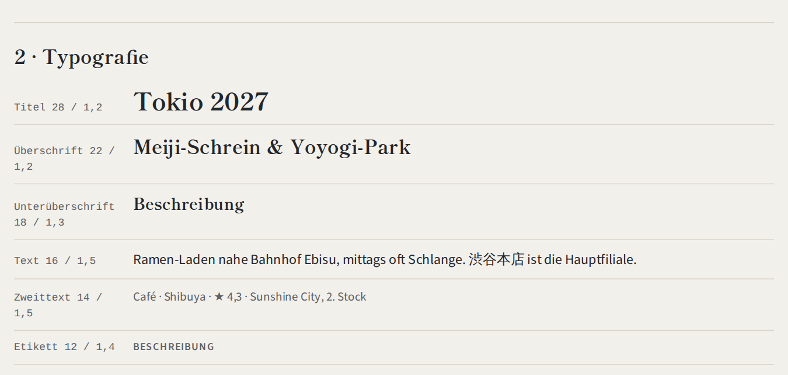

## 5. Symbole

**Prinzip:** Symbole sind **Zeichen mit Beschriftung**, nie allein.

| Element | Symbol | Größe | Regel |
|---|---|---|---|
| Kategorie-Stempel | Kanji auf Farbfläche | 38 × 38 px, Zeichen 19 px, Radius 8 | immer mit Kategorie-Wort in der Zeile, `aria-hidden` |
| Tab-Leiste | 一覧 · 地図 · ☆ | Zeichen 19 px | immer mit deutschem Wort darunter |
| Merken | ☆ leer / ★ gefüllt | 22 px, Tippfläche 48 px | Formwechsel plus Farbwechsel |
| Suche | SVG-Lupe | 17 px | `aria-hidden`, Feld hat `aria-label` |
| Karten-Punkte | Kreis in Gruppenfarbe | siehe unten | Merken = goldener Rand, Besucht = durchscheinend |

**Karten-Punkte, Ist und Soll.** Ist: Radius 6,5 px (13 px Durchmesser), gemerkt 8, geöffnet 11. Das ist für den Daumen zu klein und liegt unter der WCAG-Mindestgröße von 24 px. Soll: Radius mindestens 12 px (24 px) und eine unsichtbare Trefferfläche von 44 px.

**Kanji-Legende (Soll).** Nicht jede Person der Familie liest Kanji. Eine einzeilige Legende im Filterblatt („食 Essen · 茶 Café · 酒 Bar · 店 Shop · 市 Markt · 館 Museum · 社 Schrein · 寺 Tempel · 園 Park · 景 Sehenswürdigkeit · 宿 Hotel · 他 Sonstiges“) macht die Zeichen lernbar. Auf der Karte gibt es schon eine Legende.

## 6. Layout und Raster

### Abstände und Radien

Im Ist sind die Abstände gewachsen (6, 8, 10, 12, 13, 14, 16, 20, 24). Soll: eine Skala, neue Werte nur daraus.

| Token | 4 | 8 | 12 | 16 | 24 | 32 |
|---|---|---|---|---|---|---|
| Verwendung | Symbolabstand | Chip-Abstand | Zeilenabstand | Seitenrand | Blatt-Innenrand | Abschnitte |

| Radius | Wert | Verwendung |
|---|---|---|
| klein | 8 px | Stempel, kleine Knöpfe |
| mittel | 10 bis 12 px | Felder, Schalter |
| Blatt | 18 px | oberer Rand der Blätter |
| rund | 999 px | Chips, Pillen |

### Raster und Breakpoints

| Breite | Ist | Soll |
|---|---|---|
| bis 719 px (Handy) | eine Spalte, Tab-Leiste unten, Blätter von unten, Seitenrand 16 px | unverändert |
| 720 bis 1023 px (Tablet, kleiner Laptop) | gleiche Spalte, nur größerer Titel, Inhalt max. 820 px zentriert | unverändert |
| **ab 1024 px (Laptop)** | wie Tablet, viel leere Fläche | **zwei Spalten: Liste links (ca. 420 px), Karte rechts, Detail als Seitenleiste statt Blatt, Tab-Leiste entfällt** |

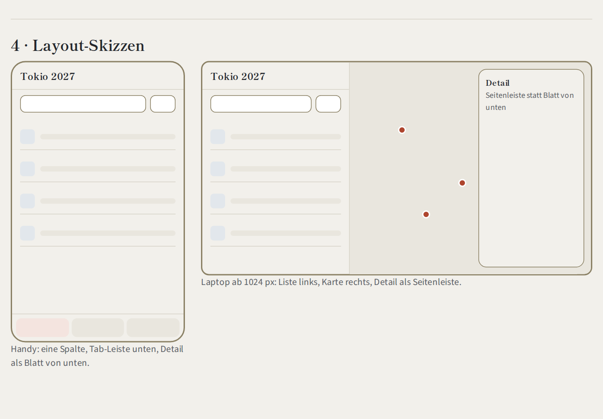

**Weitere Regeln**

- Sicherheitsabstände für Notch und Home-Leiste (`env(safe-area-inset-*)`) bleiben (im Ist vorhanden).
- Blätter maximal 640 px breit, Text maximal 62 Zeichen pro Zeile (im Ist vorhanden).
- Das Layout muss bei 320 px Breite ohne Querscrollen funktionieren (WCAG 1.4.10), die Chips-Reihe scrollt bewusst seitlich.

## 7. Navigation

**Hierarchie (Ist, beibehalten):**

```
Tab-Leiste (immer sichtbar)
├── Liste      → Suche + Chips + Filterblatt → Detailblatt
├── Karte      → Punkte → Detailblatt
└── Merkliste  → Fortschritt (besucht) → Detailblatt
```

**Regeln**

1. Genau drei Tabs. Neue Funktionen kommen als Blatt oder als Knopf in einem Tab, nicht als vierter Tab.
2. Detail und Filter sind **Blätter**: schließen mit Schließen-Knopf, Tippen auf den Hintergrund oder Esc. Der Fokus kehrt danach zum auslösenden Element zurück (im Ist so).
3. Der Zustand (Tab, Filter, Sortierung) wird gemerkt und beim nächsten Start wiederhergestellt (im Ist so).

**Lücken im Ist**

| Lücke | Wirkung | Soll |
|---|---|---|
| Kein Eintrag im Browser-Verlauf (`pushState`/`popstate` fehlen) | Die Android-Zurück-Taste oder Wischgeste schließt das Blatt nicht, sondern verlässt die App | Beim Öffnen eines Blatts Verlaufseintrag anlegen, bei Zurück Blatt schließen |
| Tab-Leiste hat `role="tab"`, aber keine Pfeiltasten und kein `aria-controls` | Am Laptop mit Tastatur umständlich, Bildschirmleser kennt die Zuordnung nicht | Pfeiltasten links/rechts, `aria-controls` auf die Ansichten |
| Ab Laptop-Breite nur Tabs | Karte und Liste nie gleichzeitig sichtbar | Zwei-Spalten-Layout (Abschnitt 6) |

## 8. Bedienelemente

### Zustände (gelten für alle Knöpfe, Chips, Schalter)

| Zustand | Darstellung |
|---|---|
| Normal | Fläche `--card`, Rand `--line-strong`, Text `--ink` |
| Hover (nur Maus) | Fläche `--paper-2` |
| Gedrückt | leicht verkleinert (97 %), entfällt bei „Bewegung reduzieren“ |
| Fokus (Tastatur) | 2 px Ring `--focus`, 2 px Abstand, nie entfernen |
| Aktiv/Ausgewählt (`aria-pressed`, `aria-selected`) | Chips und Segmente Indigo; Merken Gold-Fläche; Besucht Salbei-Fläche; Tab Zinnober-Fläche |
| Gesperrt | 45 % Deckkraft, Cursor „nicht erlaubt“ |
| Laden | Drehzeichen im Knopf, Beschriftung bleibt für Bildschirmleser (`aria-label`) |
| Fehler | Rand 2 px Zinnober plus Text **neben** dem Feld, nie nur Farbe |

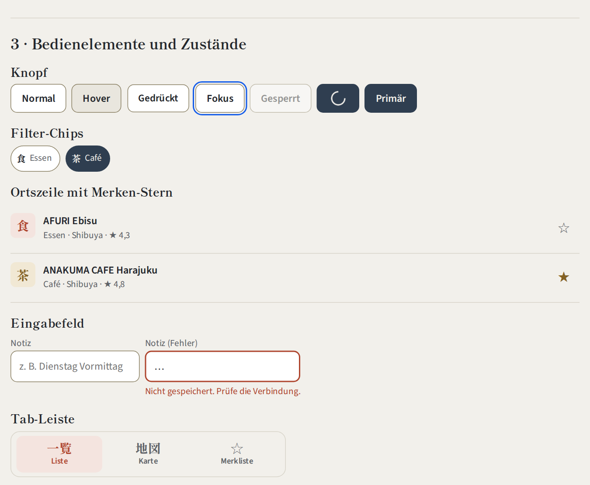
*Soll-Zustände (hell). Dunkel: [img/beispiel-komponenten-dunkel.png](img/beispiel-komponenten-dunkel.png).*

### Maße (Mindestwerte, Soll)

| Element | Ist (gemessen) | Soll |
|---|---|---|
| Ortszeile | ca. 105 px (mit zweizeiliger Beschreibung) | mindestens 64 px |
| Merken-Stern | 48 px breit | 48 × 48 px (bleibt) |
| Chip | **34 px** hoch | **40 px**, 6 px Abstand |
| Suchfeld, Filter-Knopf | 46 px | 48 px |
| Tab | 51 px | 56 px |
| Schließen-Knopf | **36 × 36 px** | **44 × 44 px** |
| Pille („Google Maps“, „Website“) | **38 px** | **44 px** |
| „Kopieren“ (kleiner Knopf) | **30 px** | **40 px** |
| Karten-Zoom | 36 px | 44 px |

Hintergrund: WCAG 2.2 verlangt mindestens 24 × 24 px (Kriterium 2.5.8, AA). Apple empfiehlt 44 pt, Material Design 48 dp. Wir nehmen 44 px für Hauptknöpfe und 40 px für dichte Reihen.

### Rückmeldungen

| Ereignis | Rückmeldung | Soll-Ergänzung |
|---|---|---|
| Merken, Besucht | Stern und Knopf wechseln sofort | – |
| Speichern fehlgeschlagen | Hinweis unten (3,2 s), Änderung wird zurückgenommen | Hinweis bis zum Wegtippen stehen lassen, Text mit Lösung („Prüfe die Verbindung und versuche es noch einmal“) |
| Karte nicht ladbar | Hinweis „Karte nicht verfügbar“, Liste bleibt nutzbar | – |
| Suche ohne Treffer | Leerer Zustand mit Überschrift und Link „zurücksetzen“ | Link als Knopf mit 44 px Höhe |
| Anzahl der Treffer ändert sich | nur sichtbar | zusätzlich `aria-live="polite"` für Bildschirmleser |

## 9. Konsistenz

**Eine Quelle.** Die App entsteht aus `quelle/app.src.html` und `quelle/orte.json` (`python3 quelle/build.py`). Das Ziel-Design liegt daneben in `docs/soll.css`. Beides zusammen ist die „Komponentenbibliothek“. Eine eigene Bibliothek lohnt bei einer Datei nicht.

**Bausteine (Ist, alle beibehalten):**

| Baustein | Klasse | Einsatz |
|---|---|---|
| Stempel | `.stamp`, `.g-food` … | Kategorie, Kopf, Detail |
| Chip | `.chip` | Kategorie-Filter |
| Segment | `.seg button` | Auswahl im Filterblatt |
| Schalter-Knopf | `.toggle` | Merken, Besucht |
| Pille | `.pill-link` | Links nach außen |
| Knopf | `.btn`, `.small-btn` | Speichern, Kopieren |
| Blatt | `.sheet` | Detail, Filter |
| Hinweis | `.toast` | Rückmeldung |
| Tab | `.tab` | Navigation |

**Regeln**

1. Vor einem neuen Baustein prüfen, ob einer der obigen passt.
2. Farben und Abstände nur aus den Tokens, keine Einzelwerte im Stil.
3. Sprache: Deutsch, Du-/Ihr-Form wie bisher („Unsere Notiz“, „was ihr euch merken wollt“), kurze Sätze, bei Fehlern immer mit Lösung.
4. Zahlen und Namen nicht fest in Texte schreiben. **Gefunden:** `manifest.webmanifest` nennt „179 Orte“, die App hat 186. Soll: Zahl aus der Beschreibung streichen.

## 10. Barrierefreiheit

**Ziel:** WCAG 2.2, Stufe AA, so weit es für eine private App sinnvoll ist. Das deutsche Barrierefreiheitsstärkungsgesetz (BFSG) betrifft nach meinem Wissen nur bestimmte kommerzielle Angebote und gilt für diese App wahrscheinlich nicht. Das sollte man bei Zweifeln prüfen.

### Was schon gut ist (im Code nachgewiesen)

- Seitensprache gesetzt (`lang="de"`), Zoom nicht gesperrt.
- Sichtbarer Fokusring auf allen Elementen (`:focus-visible`).
- Schalter mit `aria-pressed`, Merken-Knopf mit Name („Merken: AFURI Ebisu“), Schließen und Suche leeren mit `aria-label`.
- Blätter als `role="dialog"` mit `aria-modal`, Esc schließt, Fokus geht zurück.
- Dunkelmodus, `prefers-reduced-motion`, Sicherheitsabstände, Eingaben mit 16 px.
- Dekorative Stempel sind `aria-hidden`, die Kategorie steht als Text daneben.

### Was fehlt (Soll)

| Bereich | Lücke | Maßnahme |
|---|---|---|
| Kontrast | fünf Paare unter dem Ziel | Soll-Farben (Abschnitt 3) |
| Tippflächen | mehrere Elemente unter 40 px | Maße (Abschnitt 8) |
| Tastatur | Tab-Leiste ohne Pfeiltasten; keine Fokusfalle im Blatt erkennbar | Pfeiltasten; beim Öffnen restliche Seite mit `inert` sperren |
| Bildschirmleser | Bewertung als „★ 4,3“, Sterne `aria-hidden` | zusätzlich unsichtbarer Text „4,3 von 5 Sternen“ |
| Bildschirmleser | Trefferzahl ohne Ansage | `aria-live="polite"` |
| Karte | Punkte per Tastatur nicht erreichbar (Kreismarker) | Liste ist die barrierefreie Alternative, sie bleibt vollständig; Karte als „Zusatzansicht“ kennzeichnen |
| Bewegung | Blätter gleiten ein | bei „Bewegung reduzieren“ bereits aus (im Ist so) |
| Zoom | App ist `overflow: hidden` bei 100 % Höhe | bei 200 % Browser-Zoom prüfen, ob Inhalte erreichbar bleiben (WCAG 1.4.4) |

### Prüfroutine vor jeder größeren Änderung (10 Minuten)

1. `python3 tools/kontrast.py`, keine ✗ in „Soll“.
2. Nur mit Tastatur: Suche, Filter öffnen, Ort öffnen, Merken, Schließen.
3. iPhone: VoiceOver an, Liste und Detail vorlesen lassen.
4. Android: TalkBack, dasselbe.
5. Browser auf 200 % zoomen, alles bedienbar?
6. Hell und Dunkel ansehen.
7. „Bewegung reduzieren“ einschalten.
8. Handy im hellen Licht draußen: Sterne, Ränder und Untertitel erkennbar?
9. Flugmodus: Liste und Merkliste öffnen.
10. Seite bei 320 px Breite ansehen.

## 11. Nutzererlebnis, Technik und Tests

### Ladezeit und Technik

| Punkt | Ist | Soll |
|---|---|---|
| App-Datei | eine Datei, ca. 168 KB, enthält alle Orte | bleibt (186 Orte sind klein) |
| Schriften | Google Fonts (zwei Familien, sechs Schnitte) von fremden Servern | selbst mitliefern (Datenschutz, Offline) |
| Karten-Bibliothek | Leaflet 1.9.4 von cdnjs | selbst mitliefern |
| Karten-Kacheln | Esri (hell/dunkel) | bleiben online |
| Offline | `manifest.webmanifest` vorhanden, **kein Service Worker** | Service Worker legt App, Schriften und Leaflet zwischen; Liste, Merkliste und Detail laufen offline, Karte zeigt weiter den Hinweis |
| Messziele | nicht gemessen | Core Web Vitals im „guten“ Bereich: LCP ≤ 2,5 s, INP ≤ 200 ms, CLS ≤ 0,1 (mit Lighthouse messen) |

**Datenschutz-Hinweis.** Wer Google Fonts von Google-Servern lädt, übermittelt die IP-Adresse an Google. Ein Münchner Gericht hat das 2022 als unzulässig gewertet (Aktenzeichen bitte selbst nachschlagen, ich nenne es nicht aus dem Gedächtnis). Für eine private App mit Familie ist das praktisch unbedeutend. Eigene Schriften lösen es und helfen zugleich dem Offline-Betrieb.

### Browser und Geräte

| Gerät | Prüfen |
|---|---|
| iPhone, Safari (aktuell und eine Version zurück) | Hauptweg, auch als Home-Bildschirm-App |
| Android, Chrome | Zurück-Geste, Hauptweg |
| Laptop: Chrome, Safari, Firefox | Zwei-Spalten-Layout, Tastatur |
| Tablet | Spalte bis 1023 px |

Bekannt: Auf dem iPhone speichern Safari und das Home-Bildschirm-Symbol getrennt (eigene Merkliste je Weg). Empfehlung: Familie nutzt nur das Symbol.

### Tests und Verbesserung

**Fünf-Aufgaben-Test** (je Person, einmal vor der Reise, einmal in Tokio):

1. Finde ein Café in Shibuya.
2. Merke es.
3. Öffne die Merkliste und kopiere die Adresse.
4. Starte die Route mit Öffis.
5. Schreibe eine Notiz.

Notiert wird: geschafft ja/nein, Zeit, Stolpersteine. **Zyklus:** Test, die drei häufigsten Probleme beheben, mit der nächsten Person erneut testen. Eine Runde reicht, um die größten Hürden zu finden.

## 12. Dokumentation und Zusammenarbeit

**Wo liegt was?**

| Was | Datei |
|---|---|
| Orte | `quelle/orte.json` |
| App-Code und heutiges Design | `quelle/app.src.html` |
| Ziel-Design | `docs/soll.css` |
| Beispiele, Skizzen | `docs/design-beispiele.html`, `docs/img/` |
| Arbeitsablauf | `CLAUDE.md` |
| Kontrastprüfung | `tools/kontrast.py` |

**Vom Soll in die App (so wurden Farben und Tippflächen übernommen):**

1. Token-Werte direkt in den `:root`-Block von `quelle/app.src.html` schreiben und die Regeln der Bausteine dort ändern, nicht als Zusatz-Stylesheet anhängen. Der noch offene Rest (Laptop-Layout) steht in `docs/soll.css`.
2. Die Code-Punkte aus Abschnitt 7, 10 und 11 einzeln umsetzen.
3. `python3 quelle/build.py`, `python3 tools/kontrast.py`, Prüfroutine aus Abschnitt 10.
4. Änderung auf `main` pushen, GitHub Pages veröffentlicht automatisch.

**Entscheidungen festhalten.** Jede Designentscheidung, die vom Leitfaden abweicht oder ihn ändert, bekommt einen Eintrag (Vorlage unten) in `docs/entscheidungen.md`. Eine Zeile reicht.

**Übergabe.** Es gibt keine Übergabe zwischen Design und Entwicklung. Der Leitfaden ist für Menschen und für KI-Hilfen gedacht: `CLAUDE.md` verweist darauf, damit Änderungen im selben Stil entstehen.

---

## Anhang A: Vorlage Entscheidungsprotokoll

```
## 2027-01-15 · Titel der Entscheidung
Kontext:   Was war das Problem? (1 Satz)
Entscheidung: Was wurde festgelegt?
Alternativen: Was wurde verworfen und warum?
Folgen:    Was ändert sich, was ist zu prüfen?
```

## Anhang B: Vorlage Bausteinbeschreibung

```
Name:        Chip
Zweck:       Kategorie ein- und ausschalten
Aufbau:      Zeichen + Wort + Zähler, runde Pille
Zustände:    normal, hover, gedrückt, fokus, aktiv, gesperrt
Maße:        Höhe 40 px, Abstand 6 px, Radius 999 px
Barrierefreiheit: <button>, aria-pressed, Name = Wort
Nicht tun:   Zeichen ohne Wort, mehr als 12 Chips
```

## Anhang C: Prüfliste für jede Änderung

- [ ] Nur Token-Farben und Abstände aus der Skala?
- [ ] Kontrast geprüft (`tools/kontrast.py`)?
- [ ] Tippfläche mindestens 40 px, wichtige 44 px?
- [ ] Hell und Dunkel angesehen?
- [ ] Mit Tastatur bedienbar, Fokus sichtbar?
- [ ] Zeichen immer mit Wort?
- [ ] Offline getestet?
- [ ] Text auf Deutsch, Fehler mit Lösung?

## Anhang D: Werkzeuge

| Zweck | Werkzeug |
|---|---|
| Kontrast | `tools/kontrast.py`; alternativ ein Kontrastprüfer im Browser |
| Barrierefreiheit | Lighthouse (Chrome-Entwicklertools), axe DevTools |
| Geschwindigkeit | Lighthouse, WebPageTest |
| Bildschirmleser | VoiceOver (iPhone, Mac), TalkBack (Android) |
| Farbschwäche | Simulation in den Chrome-Entwicklertools (Rendering → Sehschwächen emulieren) |
| Schriften | Google Fonts (Quelle), Fontsource (zum Selbsthosten) |

## Anhang E: Quellen

Bitte beim Nachlesen auf aktuelle Fassungen achten, ich habe die Seiten für diesen Text nicht erneut abgerufen.

- W3C: Web Content Accessibility Guidelines (WCAG) 2.2, Kriterien 1.4.3 Kontrast, 1.4.4 Textgröße ändern, 1.4.10 Reflow, 1.4.11 Kontrast von Nicht-Text, 2.4.7 Fokus sichtbar, 2.5.8 Zielgröße (Minimum).
- Apple: Human Interface Guidelines (Mindestgröße von Tippflächen: 44 pt).
- Google: Material Design 3, Zielgrößen (48 dp).
- Nielsen Norman Group: 10 Usability Heuristics for User Interface Design.
- Google: Core Web Vitals (Schwellwerte LCP, INP, CLS).
- Leaflet-Dokumentation: Marker und Barrierefreiheit.
